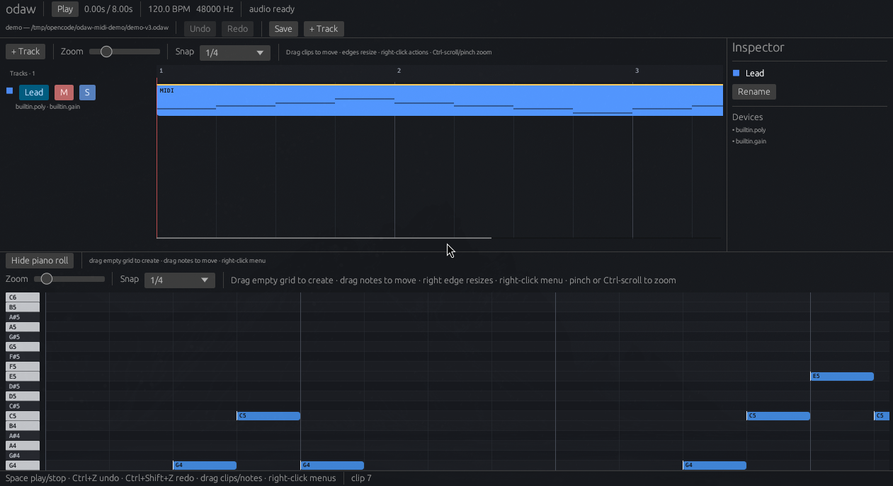

# odaw

A small, deterministic, scriptable music application. The engine is portable
and runs without a UI; the UI is one client among many.

The central model is:

```text
Project -> RenderPlan -> WAV (offline) / audio device (realtime)
```

`Project` is plain, versioned data. A compiler turns its signal graph into a
`RenderPlan`, and one engine renders that plan offline or in realtime.

## Status

This is the **first usable app shell**: the project compiles into a render plan,
schedules sample-accurate notes, renders deterministic audio offline, plays
through the sound card, and can be edited in a native track/piano-roll UI.

The UI is deliberately Ableton-like: tracks live in the timeline header, the
arrangement is the large central view, and the piano roll is a collapsible,
vertically resizable panel below it.



What works today:

- `odaw-core`: typed ids, integer `Tick`/`Frames` time with exact tempo-map
  conversion, graph/port/parameter/automation types, inline MIDI notes, the
  persistent `Project`, and structural validation.
- `odaw-control`: versioned commands, the `Tx` staging area, the single
  dispatcher, `ChangeSet` tracking, bounded `History` with undo/redo, operators
  and their registry, and a `Session` that owns the document, history, selection,
  and effects hook.
- `odaw-engine`: the immutable `RenderPlan`, a typed parameter buffer, a block
  executor, note events, a sample-accurate scheduler, and a lock-free realtime
  handoff.
- `odaw-dsp`: primitive in-tree devices (`builtin.sine`, `builtin.poly`,
  `builtin.gain`, `builtin.pass`), an audio-clip player with linear resampling,
  a built-in track/master channel strip with dB gain and stereo pan, a
  latency-compensation delay, and a demo song.
- `odaw-vst3`: a VST3 backend behind the `DeviceFactory`/`DeviceProcessor`
  boundary. It scans standard Linux bundles into a cache, loads instruments and
  effects, maps `param.<id>` normalized parameters into `Node.params`, saves
  component/controller state into `Node.state`, forwards note events, reports
  latency for compensation, and opens standalone X11/XWayland editor windows.
  `vst3-host` is MIT-licensed and ships its own bindings, so no VST3 SDK code is
  linked into the tree.
- `odaw-compile`: rack flattening, deterministic DAG ordering, cycle detection,
  port/channel checks, and plan construction.
- `odaw-render`: deterministic offline rendering.
- `odaw-io`: WAV writing plus WAV/MP3 decoding to interleaved samples, waveform
  peaks, and duration.
- `odaw-platform`: `cpal` output with f32/i16/u16 conversion.
- `odaw-format`: versioned DTOs, postcard payloads, JSON manifests, and
  v1–v4 → v5 migration. Track names, colors, mute, solo, display order,
  plugin state, and automation lanes are persisted.
- `odaw-ui` / `odaw-app`: Ableton-like timeline with track headers, colors,
  names, mute/solo, per-track gain/pan faders with live stereo level meters, and
  a single stereo master out strip in the timeline. Clips move/resize/split/
  duplicate and support marquee multi-selection, grid zoom, and snapping. The
  collapsible/resizable bottom panel has Notes, Automation, and Clip/Track tabs.
  Automation lanes can be created from any mixer or plugin parameter control,
  edited with points and Hold/Linear segments, switched between Absolute and
  Trim, enabled/disabled, recorded from touch gestures, and shown as expandable
  rows under a track. The piano roll adds a note on a tap, marquee-selects on a
  drag, and edits note groups with move, transpose, copy/paste, and duplicate.
  It also has note resize, right-click menus, snap, trackpad zoom, undo, and
  redo. Snap follows the horizontal zoom from 1/1 down to 1/128 in both the
  arrangement and piano roll; **Snap** turns it on/off and **1/3** switches to
  triplet divisions. Faint guide lines track the active division. Zoom supports
  Ctrl+wheel and trackpad pinch, widens down to 0.05 px/beat, and **Fit** shows
  the whole song or clip. The piano roll spans C0–C7. Up/Down transposes
  selected notes or moves the selected track when no notes are selected, and
  the track headers share the timeline row height. The track header column has
  a draggable width so its gain/pan/meter controls stay usable. Click the ruler
  or empty timeline to seek the red cursor; Ctrl+E splits
  the selection at the cursor. Tempo is editable in the transport; the Time
  dialog (Ctrl+T or the `Time` button) sets the bar/beat position, tempo, and
  time signature. Audio files
  can be dropped onto the timeline as clips with waveform previews and played
  back through the track's gain/pan strip. The bottom panel follows the
  selection: the piano roll for MIDI clips, an audio clip detail view with a
  large waveform for audio clips, and track options (colors, mute/solo, mixer,
  clips, devices) in both cases. Edits go through `Session`; structural edits
  are recompiled and published to the realtime engine, while fader gestures
  update the live parameter buffer and commit one value-only command on
  release. Automation edits compile only a new automation plan and swap it into
  the live engine; they never rebuild the graph. A plugin browser scans VST3
  bundles in the background; an instrument
  is added as a new track and an effect is appended to the selected track's
  rack. The device list is the serial signal chain: effects can be reordered or
  removed, and each VST3 device exposes a generic normalized parameter panel, a
  floating editor window, explicit state capture, and a host-level
  bypass/enable toggle. Saving and closing an
  editor persist component/controller state and current parameters into the
  project.
- `odaw`: a CLI for create, inspect, rename, demo, validate, render, play, and
  VST3 discovery.
- CI: formatting, clippy with warnings denied, and the workspace test suite.

Current limits: mono/stereo only, devices must live in a rack, the output
device must support the project sample rate directly, audio clips are not
time-stretched when the tempo changes, MIDI notes are not recorded from
hardware, track grouping is not implemented, there is no file dialog, no
velocity lane, and no loop transport. Automation supports Hold and Linear
segments and touch recording; curve shapes, write/latch modes, and
sample-accurate VST3 parameter changes are still future work. Note
group copy/paste stays within the selected MIDI clip. VST3 support is
first-pass: one main audio input/output bus, block-accurate parameters, no
instance retention across structural edits (state is captured and restored),
no process isolation, and editor windows are floating X11/XWayland windows.

See [ROADMAP.md](ROADMAP.md) for the product path and
[.opencode/DESIGN.md](.opencode/DESIGN.md) for the architecture.

## Build and test

```sh
cargo test --workspace
cargo clippy --workspace --all-targets -- -D warnings
cargo fmt --all --check
```

## Try it

```sh
cargo run -p odaw-cli -- new song.odaw
cargo run -p odaw-cli -- inspect song.odaw
cargo run -p odaw-cli -- inspect song.odaw --json
cargo run -p odaw-cli -- rename song.odaw "New name"
cargo run -p odaw-cli -- demo demo.odaw
cargo run -p odaw-cli -- render demo.odaw -o demo.wav --duration 2
cargo run -p odaw-cli -- play demo.odaw
cargo run -p odaw-app -- demo.odaw
cargo run -p odaw-cli -- demo-automation automation.odaw
cargo run -p odaw-cli -- render automation.odaw -o automation.wav
cargo run -p odaw-cli -- validate song.odaw
cargo run -p odaw-cli -- automation list song.odaw
cargo run -p odaw-cli -- automation set song.odaw --node 1 --param gain_db --tick 0 --value -6
cargo run -p odaw-cli -- plugins --refresh
cargo run -p odaw-cli -- plugins --json
cargo run -p odaw-cli -- demo-dexed examples/ode-to-joy.odaw
cargo run -p odaw-cli -- render examples/ode-to-joy.odaw -o ode.wav
```

`examples/ode-to-joy.odaw` is a six-track Dexed arrangement of Ode to Joy:
lead, diatonic harmony, syncopated bass, offbeat bass bell, pad, and arpeggio,
with Hall reverb on the lead and Plate reverb on the pad. `demo-dexed`
regenerates it from the installed plugin catalogue.

`examples/automation-demo.odaw` is the same arrangement with 14 automation
lanes: Dexed cutoff, resonance, feedback, and operator output; Dragonfly Hall
and Plate reverb level and size; lead, bell, and arp pan; bass gain; and a
master fade-out. `demo-automation` regenerates it from the installed plugins.

A container is a directory:

```text
song.odaw/
├── manifest.json
├── project.postcard
├── assets/          # reserved for content-addressed blobs
└── cache/           # disposable
```

The asset directory is created but asset blobs are not stored yet; content
addressing and the `AssetStore` arrive with the render/asset work.

## Layout

```text
core/             pure document types and validation
engine/           RenderPlan, parameter buffer, block executor
dsp/              primitive in-tree devices and the demo project
compile/          Project -> RenderPlan
io/               decoders and encoders
render/           offline renderer
platform/         cpal audio backend
format/           versioned DTOs, migrations, container I/O
control/          commands, staging, dispatch, history, operators, selection
vst3/             VST3 device factory, scan cache, processor, editor windows
ui/               egui application shell, timeline, piano roll
apps/odaw-cli/    headless CLI
apps/odaw-app/    native app
```

The remaining crates from `DESIGN.md` (`plugins`, `script`, `protocol`, ...) are
added when their phase starts, so the tree never carries empty placeholders.

## Design documents

- [.opencode/DESIGN.md](.opencode/DESIGN.md) — decisions and vocabulary.
- [.opencode/LTPLAN.md](.opencode/LTPLAN.md) — phase sequencing.
- [.opencode/CODING_GUIDELINES.md](.opencode/CODING_GUIDELINES.md) — how code
  is written.
- [docs/VST3.md](docs/VST3.md) — VST3 backend boundaries, mapping, and limits.
- [docs/AUTOMATION.md](docs/AUTOMATION.md) — automation semantics, render plan,
  and editor proposal.
